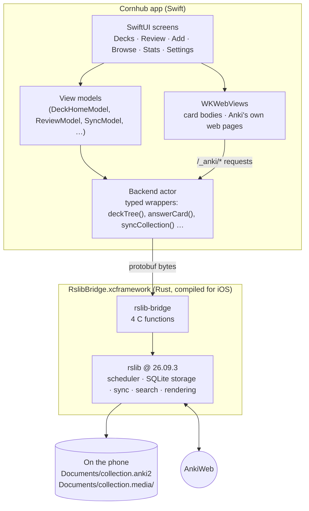
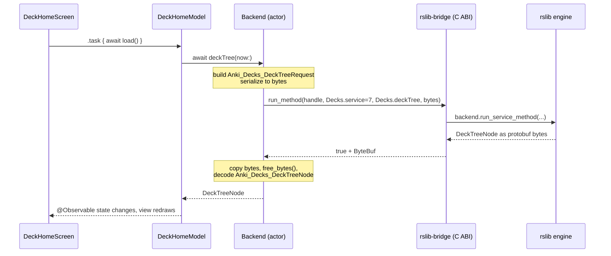
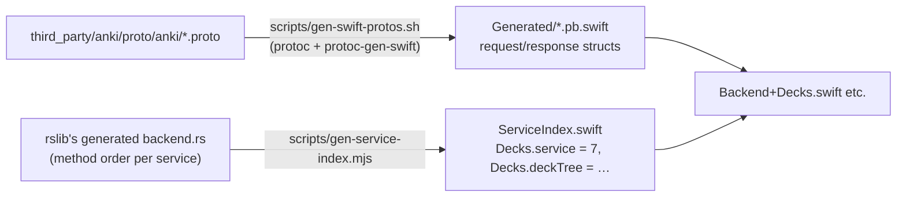
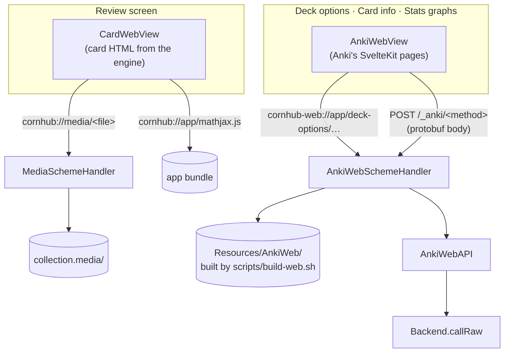
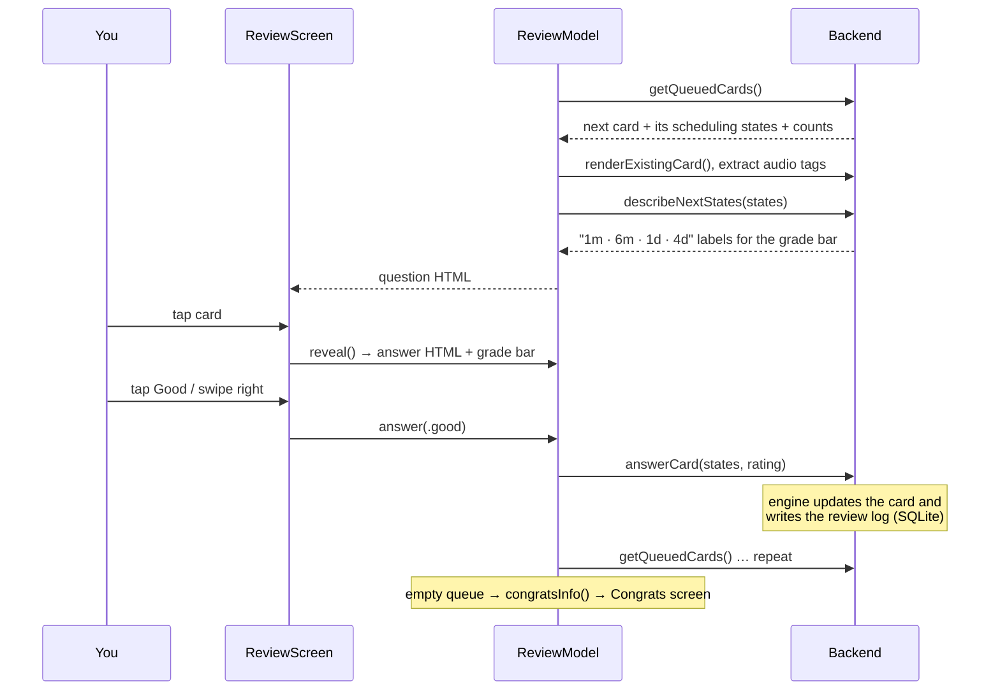
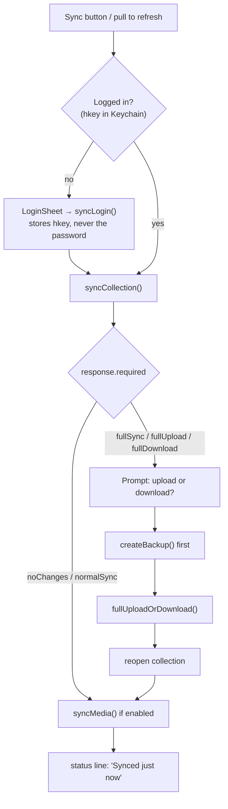
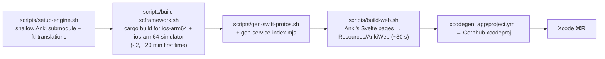
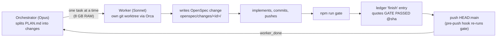

# Architecture

How Cornhub is put together, from the SwiftUI screens down to Anki's Rust engine. The diagrams are Mermaid, which GitHub renders inline. For what to build, see `PLAN.md`; for code rules, see `CONVENTIONS.md`.

## The big idea

Cornhub doesn't re-implement Anki. It embeds **Anki's own engine** (`rslib`, the Rust core that desktop Anki also uses) and puts a native iPhone interface on top. That's why the scheduling, the collection file format and AnkiWeb sync match desktop exactly: it's the same code, pinned to the same version (`26.09.3`).



## Layer by layer

| Layer | Where | What it does |
|---|---|---|
| Engine | `third_party/anki/rslib` (git submodule, tag `26.09.3`) | Everything Anki actually *does*. Untouched upstream code. |
| Bridge | `crates/rslib-bridge/src/lib.rs`, `rslib_bridge.h` | A tiny C API so Swift can call Rust. ~100 lines of real code. |
| XCFramework | `build/RslibBridge.xcframework` (built, git-ignored) | The bridge plus engine compiled as a static library for iPhone and for the simulator. |
| Protobuf types | `app/Cornhub/Backend/Generated/*.pb.swift` | Swift structs generated from Anki's `.proto` files: the "language" Swift and Rust speak. |
| Service index | `app/Cornhub/Backend/ServiceIndex.swift` | Generated numbers that say *which* engine method to call. |
| Backend | `app/Cornhub/Backend/Backend*.swift` | A Swift `actor` with one typed function per engine method we use. |
| Screens | `app/Cornhub/Screens/*`, `Sync/`, `Web/` | SwiftUI views and their view models. |
| Theme | `app/Cornhub/Theme/` + asset catalog | The "Ink" colour tokens, Space Grotesk font, radii. |

### 1. The bridge: four C functions

Anki's engine already has a single entry point used by desktop Anki's Python: *"run method M of service S with these protobuf bytes, give me protobuf bytes back"*. The bridge just exposes that to C:

```c
void *open_backend(const uint8_t *init, size_t len);   // create an engine instance
bool  run_method(void *h, uint32_t service, uint32_t method,
                 const uint8_t *in, size_t len, ByteBuf *out);  // call anything
void  free_bytes(ByteBuf buf);                          // give Rust its memory back
void  close_backend(void *h);
```

`run_method` returns `true` with the response bytes, or `false` with an encoded `BackendError` (for example "deck not found"). The Swift side turns that into a typed `BackendError`.

### 2. What one call looks like

Example: the Decks screen asks for the deck tree.



Why an **actor**: calls run one at a time and never on the main thread, so the UI stays smooth. Long jobs that need progress reporting (sync, deck-options optimisation) use `callConcurrently`/`callRaw`, so `latestProgress` can be polled while they run.

### 3. Where the method numbers come from

The engine identifies methods by number, not name. Those numbers change between Anki versions, so they're never typed by hand:



Upgrading Anki = bump the submodule tag, rebuild the XCFramework, regenerate both. Desktop and phone must be on the same version for AnkiWeb sync.

## Rendering cards and Anki's web pages

Two kinds of web view, each with its own custom URL scheme so pages can load files without a web server:



- **Card bodies**: the engine renders a card's question/answer HTML (templates, cloze, `{{tts}}`, `[sound:]` tags extracted separately). Cornhub wraps it in a page with the Ink base stylesheet and MathJax, and native SwiftUI chrome (header, grade bar, swipe gestures) sits around it. Audio plays natively (`CardAudio`: AVAudioPlayer for files, AVSpeechSynthesizer for TTS).
- **Hosted Anki pages**: rarely used, complex screens (deck options/FSRS, card info, graphs) are Anki's *own* Svelte pages, built from the pinned source. Desktop Anki serves them from a local Python web server (`mediasrv.py`); Cornhub replaces that server with `AnkiWebSchemeHandler`, which serves the files and forwards each `/_anki/<method>` call straight into the engine. An Ink CSS override makes them match the app.

## The review loop



The intervals and due counts are always the engine's numbers, never computed in Swift. Undo/redo, bury, suspend, flag and custom study are each one engine call.

## Sync with AnkiWeb



A normal sync merges changes both ways. A *full* sync (after schema changes, or the first time) replaces one side wholesale, so the app always asks and takes a backup first. Progress text comes from `latestProgress`, polled while the sync runs.

## Data on the phone

| What | Where |
|---|---|
| Collection (SQLite) | `Documents/collection.anki2` |
| Media | `Documents/collection.media/` |
| Backups | `Documents/` backups folder (`createBackup`) |
| AnkiWeb login key | Keychain (`AccountStore`) |
| Small preferences | `UserDefaults` (sync media on/off, etc.); scheduling prefs live in the collection |

Same file format as desktop, so `.colpkg`/`.apkg` import and AnkiWeb sync move data between them.

## Building it



`scripts/bootstrap.sh` runs all of it in order and skips steps whose output already exists. The XCFramework and web pages are git-ignored build output; the generated Swift files and the Xcode project are committed.

## How the code gets written (the agent workflow)

The app is built by AI agents, coordinated rather than reviewed:



- **OpenSpec** (`openspec/specs/`, `openspec/changes/`): each feature is a written change (proposal, tasks, spec delta) before code; archived changes become the living spec.
- **Ledger** (`ledger/LEDGER.jsonl`): append-only log of who started and finished what, with proof.
- **Gate** (`tools/gate.mjs`): protected-file check, ledger check, spec validation, then `tools/verify.mjs`. **Demo mode** (current) only checks formatting and that the app compiles; `ANKICORN_FULL=1` runs clippy, Rust tests and the Xcode unit/UI tests, which happens in the final sweep.

## Glossary

- **rslib**: Anki's Rust core library.
- **Collection**: your whole Anki database (decks, notes, cards, review history), one SQLite file.
- **Note / card**: a note holds fields (Hanzi, English…); its note type's templates generate one or more cards from it.
- **FSRS**: the modern scheduling algorithm in Anki; parameters live in deck options.
- **hkey**: the AnkiWeb session key returned by login; stored instead of your password.
- **XCFramework**: Apple's bundle format for a library built for several platforms (device + simulator).
- **Actor**: a Swift type whose methods run one at a time, off the main thread.
